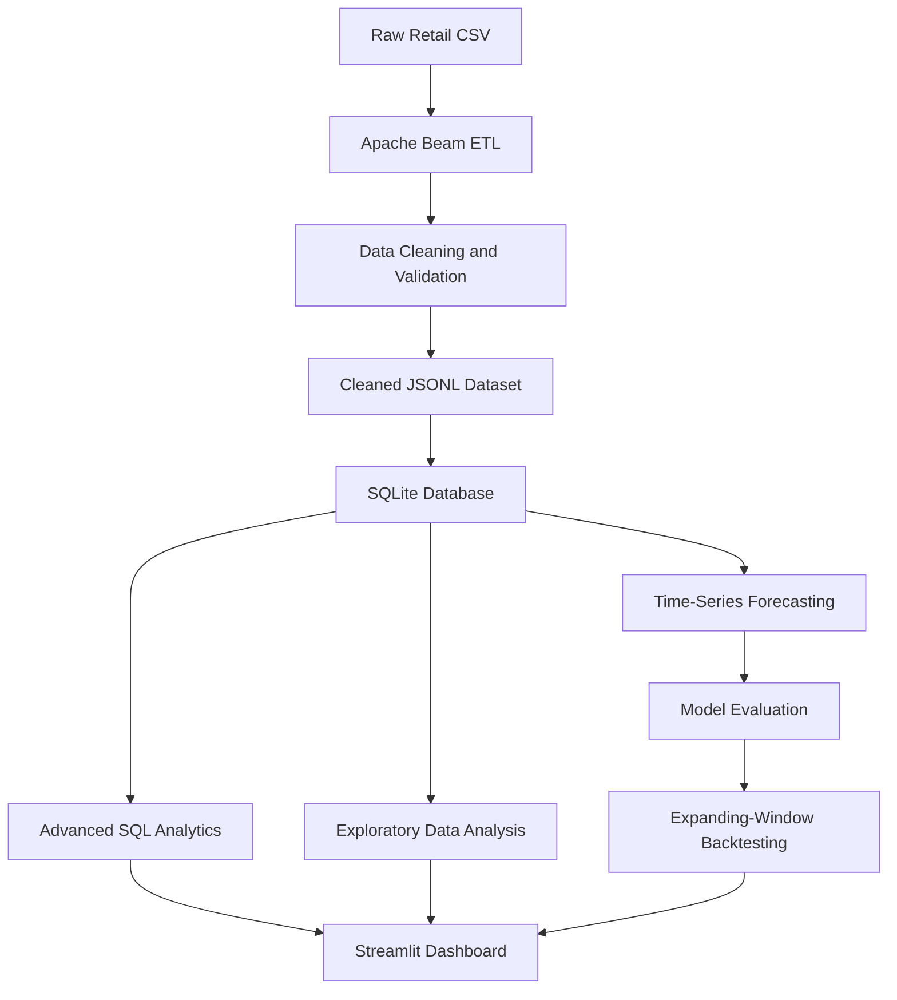

# Retail Sales Analytics & Time-Series Forecasting

**Developer: Akanksha Masih**

An end-to-end retail analytics and time-series forecasting
system integrating data engineering, advanced SQL analytics,
statistical modeling, model evaluation, and interactive
business intelligence.

## Project Overview

This project transforms raw retail transaction data into
actionable business insights through an automated ETL
pipeline, relational database, statistical forecasting
models, and an interactive dashboard.

The system analyzes historical sales performance,
revenue growth, profitability, seasonal patterns,
and forecasting accuracy to support data-driven
business decisions.

## Business Objectives

- Automate retail data ingestion and transformation.
- Ensure data quality and consistency.
- Analyze revenue, profitability, and sales growth.
- Identify seasonal sales patterns.
- Benchmark time-series forecasting models.
- Evaluate model performance on unseen historical data.
- Visualize business KPIs through interactive dashboards.

## System Architecture



## Technology Stack

| Technology | Purpose |
|---|---|
| Python | Data processing and modeling |
| Apache Beam | Automated ETL pipeline |
| SQLite | Relational database |
| SQL | Business analytics |
| Pandas | Data manipulation and analysis |
| NumPy | Numerical computation |
| Statsmodels | Statistical forecasting |
| Scikit-learn | Model evaluation |
| Matplotlib | Statistical visualization |
| Plotly | Interactive visualization |
| Streamlit | Business intelligence dashboard |
| Git & GitHub | Version control |

## Dataset

The dataset contains historical retail sales transactions
from January 2014 to December 2017.

| Metric | Value |
|---|---:|
| Transaction records | 2,121 |
| Unique orders | 1,764 |
| Monthly observations | 48 |
| Missing values after processing | 0 |
| Duplicate row IDs | 0 |
| Data retention | 100% |

### Dataset Features

- Row ID
- Order ID
- Order Date
- Ship Date
- Sales
- Quantity
- Profit
- Profit Margin

## Data Engineering Pipeline

The Apache Beam pipeline performs:

- CSV ingestion and parsing
- Data cleaning and transformation
- Date standardization
- Numeric type conversion
- Profit margin calculation
- Structured JSONL generation

The transformed data is loaded into SQLite for
relational analysis and automated reporting.

The local pipeline uses Apache Beam DirectRunner,
allowing execution without cloud infrastructure.

## Data Quality Validation

The processed dataset was evaluated for:

- Record completeness
- Missing values
- Duplicate row identifiers
- Data type consistency

All 2,121 source records were retained, with no
missing values or duplicate row IDs detected.

## SQL Business Analytics

SQL queries automate the generation of:

- Total revenue and profit
- Unique order counts
- Average order value
- Overall profit margin
- Monthly revenue growth
- Annual financial performance

### SQL Techniques

- Common Table Expressions (CTEs)
- Window functions
- LAG()
- Aggregations
- Date transformations
- Conditional calculations
- Division-by-zero handling

Analytics results are automatically exported into
CSV reports.

## Exploratory Data Analysis

The exploratory analysis investigates:

- Monthly revenue trends
- Yearly revenue and profitability
- Transaction sales distribution
- Monthly seasonality
- Relationship between sales and profit
- Descriptive statistics and correlation

## Key Business Findings

| Business Metric | Result |
|---|---:|
| Total revenue | $741,999.80 |
| Total profit | $18,451.27 |
| Overall profit margin | 2.49% |
| Unique orders | 1,764 |
| Loss-making transactions | 714 |
| Aggregate transaction losses | $60,936.11 |

### Business Insights

- Sales exhibit seasonal patterns, with strong
  average revenue during November and December.
- High revenue does not necessarily translate
  into high profitability.
- Transaction sales exhibit a right-skewed distribution.
- Loss-making transactions highlight opportunities
  for further profitability investigation.

## Time-Series Forecasting

Three forecasting approaches were implemented
and benchmarked:

### Seasonal Naive

Uses historical sales from the corresponding
period of the previous year as a baseline.

### Holt-Winters Exponential Smoothing

Models sales using additive trend and
annual seasonality components.

### SARIMA

Models temporal dependencies using seasonal
autoregressive integrated moving averages.

## Model Evaluation

### Evaluation Metrics

- Mean Absolute Error (MAE)
- Root Mean Squared Error (RMSE)
- Weighted Absolute Percentage Error (WAPE)

### Chronological Holdout Evaluation

Training period: January 2014 - December 2016

Testing period: January 2017 - December 2017

| Model | MAE | RMSE | WAPE |
|---|---:|---:|---:|
| Seasonal Naive | 3747.03 | 4473.38 | 20.88% |
| Holt-Winters | 3979.85 | 4574.42 | 22.17% |
| SARIMA | 5978.05 | 7241.00 | 33.31% |

Seasonal Naive achieved the lowest forecasting
error in the 12-month holdout evaluation.

### Expanding-Window Cross-Validation

Four chronological validation folds were evaluated
using a six-month forecast horizon.

| Model | Mean MAE | Mean RMSE | Mean WAPE |
|---|---:|---:|---:|
| Holt-Winters | 3139.16 | 3618.70 | 21.02% |
| Seasonal Naive | 3462.57 | 4563.57 | 22.05% |
| SARIMA | 6768.50 | 8056.64 | 48.73% |

Holt-Winters achieved approximately 9.34% lower
average MAE than the Seasonal Naive baseline
during expanding-window cross-validation.

The results demonstrate the importance of baseline
benchmarking, chronological validation, and
evaluating models across multiple forecasting periods.

## Interactive Dashboard

The Streamlit dashboard provides four analytical modules:

### Executive Overview

- Revenue and profit KPIs
- Unique orders
- Overall profit margin
- Monthly revenue trends
- Annual financial performance

### Sales Analysis

- Sales distribution
- Seasonal revenue patterns
- Descriptive statistics
- Interactive year filters

### Profitability Analysis

- Sales versus profit visualization
- Loss-making transaction analysis
- Aggregate transaction losses

### Sales Forecasting

- Actual versus predicted sales
- Forecasting model comparison
- Holdout evaluation metrics
- Expanding-window cross-validation results
- Interactive metric selection

## Installation

Python 3.11 is recommended.

```bash
pip install -r requirements.txt
```

## Running the Project

The source dataset is not distributed with this
repository. Obtain an authorized copy before
running the full pipeline.

After obtaining the authorized dataset and a
redistributable ETL implementation, execute
the pipeline, then run:

```bash
python dataflow/load_to_sqlite.py
python analytics/run_sql.py
python analytics/eda.py
python models/sales_forecasting.py
python models/backtesting.py
python -m streamlit run dashboard/app.py
```

Open the dashboard at:

http://localhost:8501

## Skills Demonstrated

- Data Engineering
- ETL Pipeline Development
- Data Quality Validation
- Advanced SQL
- Statistical Analysis
- Exploratory Data Analysis
- Time-Series Forecasting
- Predictive Analytics
- Model Benchmarking
- Cross-Validation
- Business Intelligence
- Dashboard Development

## Limitations

- The dataset contains only 48 monthly observations.
- SARIMA hyperparameters were not extensively optimized.
- Holdout and backtesting evaluation periods overlap.
- The two evaluation methods use different forecast horizons.
- Forecasting results represent historical model evaluation.
- Cloud deployment has not been implemented or validated
  as part of the local extension.

## Future Improvements

- Automated data quality testing
- Hyperparameter optimization
- Forecast prediction intervals
- Future-period sales forecasting
- Automated pipeline orchestration
- Google Cloud integration
- CI/CD with GitHub Actions
- Model performance monitoring

## Developer

**Akanksha Masih**

MSc Computer Science - Artificial Intelligence

University of Windsor

GitHub: https://github.com/Akankshamasih05

